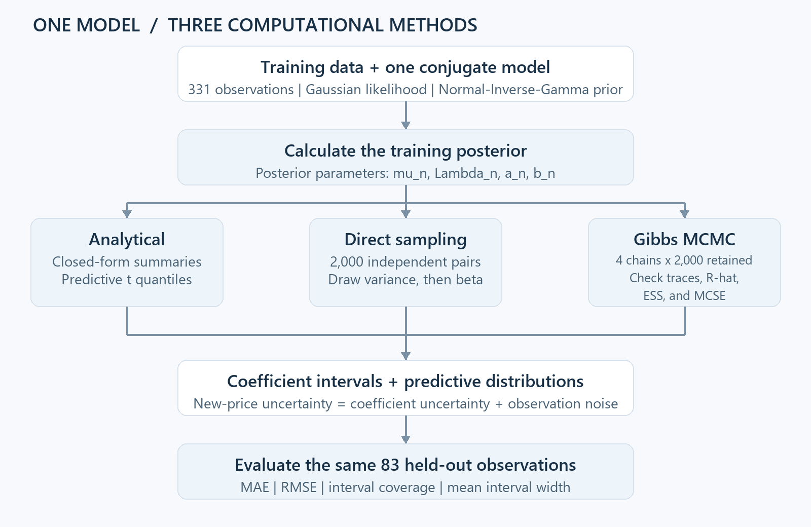
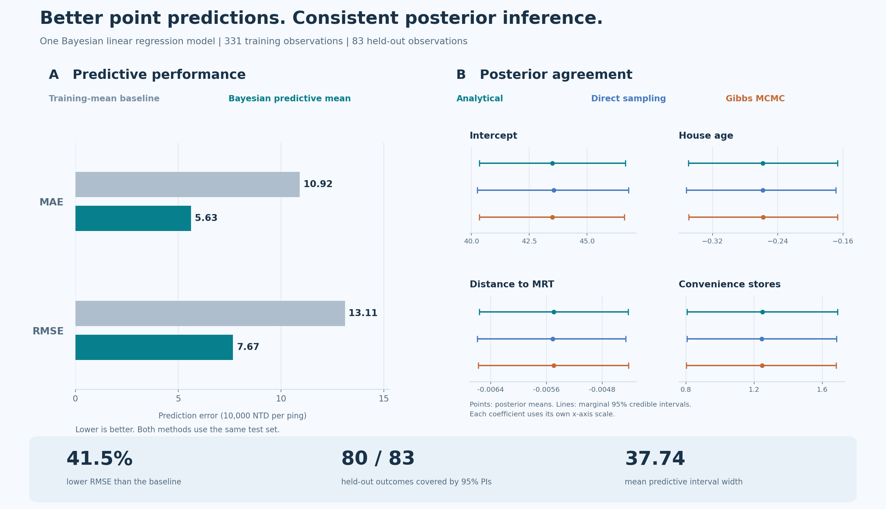

# Bayesian House Price Prediction and Uncertainty Quantification

Predict house prices, quantify uncertainty, and validate three ways of computing the same Bayesian posterior.

[Explore the notebook](bayes_project.ipynb) · [Open in Colab](https://colab.research.google.com/github/noddleslee/bayesian-house-price-prediction/blob/main/bayes_project.ipynb) · [Reproduce the analysis](#reproduce-the-analysis)

**41.5% lower test RMSE** than the training-mean baseline · **80/83 outcomes covered** by 95% predictive intervals · **Three inference methods in close agreement**

## What questions does this project answer?

### 1. Does the model improve house-price prediction?

On the same 83 held-out observations, the analytical Bayesian predictive mean reduces **MAE from 10.92 to 5.63** and **RMSE from 13.11 to 7.67**. The baseline predicts the training-target mean for every property. The target is **price per unit area**, measured in **10,000 NTD per ping**.

### 2. Do analytical inference, direct sampling, and Gibbs MCMC agree?

The coefficient means and marginal 95% credible intervals align closely in panel B. Their test predictions also agree:

| Inference method | MAE | RMSE | 95% PI coverage | Mean PI width |
|:--|--:|--:|--:|--:|
| Analytical | 5.6319 | 7.6734 | 96.3855% | 37.7424 |
| Direct sampling | 5.6353 | 7.6757 | 96.3855% | 37.7311 |
| Gibbs MCMC | 5.6320 | 7.6731 | 96.3855% | 37.6886 |

All three methods use **the same data, likelihood, and prior**. Small numerical differences are consistent with Monte Carlo error; they do not establish that one method predicts better. The sampling budgets differ: 2,000 independent direct draws versus 8,000 retained Gibbs draws, so this is an agreement check, not an equal-budget speed comparison.

### 3. How uncertain are individual price predictions?

The analytical 95% posterior predictive intervals cover **80 of 83** test outcomes (**96.39%**), with a mean width of **37.74 target units**. Coverage must be read together with width: the intervals are broad.

Under the fitted model, observation noise dominates that width. A noise-only reference, holding the fitted posterior fixed, is **37.49** units wide. Predictive intervals include both coefficient uncertainty and new observation noise; coefficient credible intervals describe uncertainty about regression parameters.

### 4. Can we trust the Gibbs samples?

Four chains each retain 2,000 draws after discarding 1,000 initial iterations. The saved diagnostics show **maximum R-hat = 1.00044**, bulk ESS of approximately **7,700-8,200**, and small Monte Carlo standard errors. Trace plots are included in the notebook.

These checks, together with agreement with the analytical posterior, support the sampling implementation. They do not establish that the model assumptions are adequate.

<strong>View the full MCMC diagnostic table</strong>

| Parameter | Bulk ESS | Tail ESS | R-hat | MCSE of mean | MCSE of SD |
|:--|--:|--:|--:|--:|--:|
| Intercept | 7793.27 | 7771.67 | 0.999967 | 0.018329 | 0.0127153 |
| House age | 8226.75 | 7823.11 | 1.000290 | 0.000508873 | 0.000364277 |
| MRT distance | 8014.45 | 8095.44 | 1.000440 | 0.00000615405 | 0.00000461509 |
| Convenience stores | 7895.47 | 7989.91 | 0.999779 | 0.00253879 | 0.00180176 |
| Noise variance | 7718.94 | 7808.93 | 1.000010 | 0.0807425 | 0.0608814 |

R-hat uses the rank-normalized split diagnostic. ESS is an estimate and may slightly exceed the retained draw count. MCSE measures numerical precision, rather than posterior uncertainty.

<strong>Data, model, and inference details</strong>

The [UCI Real Estate Valuation dataset](https://archive.ics.uci.edu/dataset/477/real+estate+valuation+data+set) contains 414 observations from Sindian District, New Taipei City, Taiwan. This analysis uses house age, distance to the nearest MRT station, and the number of convenience stores, plus an intercept.

The split uses 331 training and 83 test observations with <code>random_state=42</code>. Predictors remain on their original scales.

$$
y\mid\beta,\sigma^2,X\sim\mathcal N(X\beta,\sigma^2I),\qquad
\beta\mid\sigma^2\sim\mathcal N(\mu_0,\sigma^2\Lambda_0^{-1}),\qquad
\sigma^2\sim\operatorname{InvGamma}(a_0,b_0).
$$

The shared prior uses $\mu_0=0$, $\Lambda_0=0.01I$, and $a_0=b_0=1$, with inverse-gamma shape/scale parameterization.

- **Analytical:** closed-form posterior summaries and Student-t marginal coefficient and posterior predictive intervals.
- **Direct sampling:** draw variance from its marginal posterior, then coefficients conditional on that variance.
- **Gibbs MCMC:** alternate coefficient and variance full-conditional draws; diagnose chains before evaluating their predictions.

Point predictions use the predictive mean. New observation noise is included when generating predictive intervals.

## Reproduce the analysis

Use **Python 3.12+** and a fresh environment:

~~~bash
git clone https://github.com/noddleslee/bayesian-house-price-prediction.git
cd bayesian-house-price-prediction
python -m pip install -r requirements.txt
python -m jupyter lab bayes_project.ipynb
~~~

Run the notebook from top to bottom. Internet access is needed to fetch UCI dataset 477. The notebook also includes installation cells for <code>ucimlrepo</code> and the ArviZ diagnostic packages.

Fixed seeds: split and direct posterior draws <code>42</code>; Gibbs chains <code>100-103</code>; Gibbs predictive simulation <code>2026</code>; direct predictive simulation <code>2027</code>. Small Monte Carlo or diagnostic differences can occur across software versions.

The committed outputs document the supplied analysis run. The README figure is rebuilt from its saved, rounded summaries in <code>results.json</code>:

~~~bash
python scripts/build_results.py
~~~

## Scope and limitations

- One fixed split of a small dataset; results do not establish performance across populations or time.
- Three predictors, linear effects, and constant Gaussian observation noise; residual assumptions have not been independently validated here.
- Predictive intervals are broad, and coverage on 83 observations is not proof of calibration.
- Predictors are unstandardized, so the common numeric prior precision has different implications across coefficient scales.
- Coefficient associations do not establish causality. Agreement between inference methods checks computation under the selected model.

**Dataset credit:** Yeh, I. (2018). *Real Estate Valuation* [Dataset]. UCI Machine Learning Repository. [doi:10.24432/C5J30W](https://doi.org/10.24432/C5J30W). Dataset license: [CC BY 4.0](https://creativecommons.org/licenses/by/4.0/).
